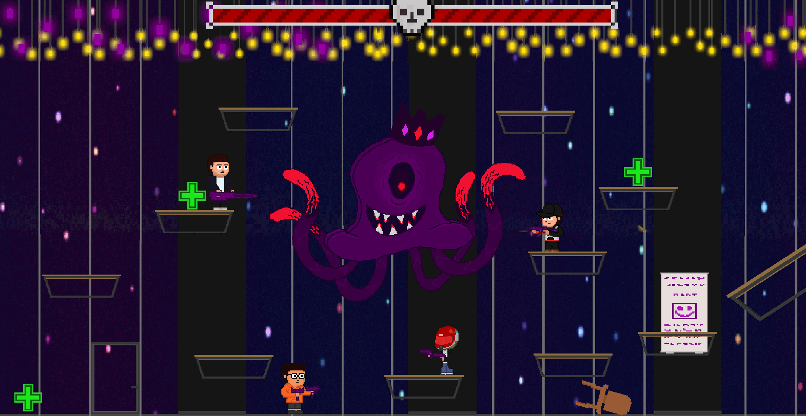
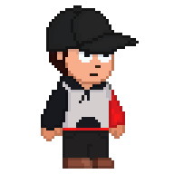
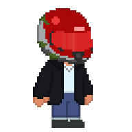
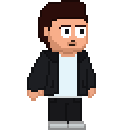
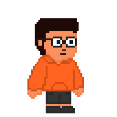
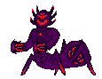
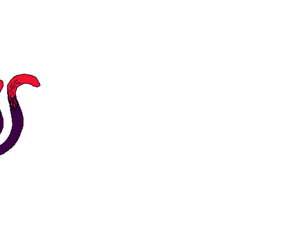
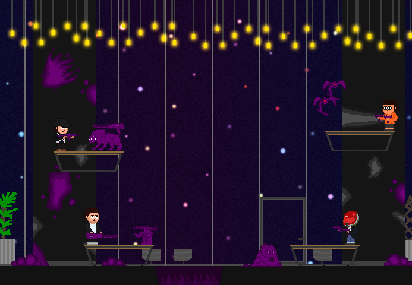

# UNI-MALY

**Two-player arcade run-and-gun · Local co-op · Unity 2D · Gamepad-only gameplay**

**[Download & play on itch.io](https://alikb.itch.io/uni-maly)** · **[Game Design Document](UNI-MALY_GDD.pdf)** · **[Technical overview](Docs/TECHNICAL_OVERVIEW.md)**

  

Actual gameplay capture: the two-player battle against Dottopus, the Digital Game Design Club mascot.

> **Project status: Playable student-game prototype.** UNI-MALY was developed as a two-player arcade-cabinet experience and is distributed as a Windows build. It is designed to be played with **two gamepads**, not with a keyboard-and-mouse control scheme.

## The game

### Campus Anomaly

An unexplained anomaly spreads across a university campus, transforming the familiar environment into territory occupied by hostile creatures. Four students are the campus's last line of defense.

In this **2D co-op run-and-gun shooter**, two players fight their way through the corrupted university, defeat different enemy types, and confront two bosses. The final encounter is against **Dottopus**, the mascot of our university's Digital Game Design Club — reimagined as the climactic boss of the game.

The four playable students are based on our group of friends, with distinct silhouettes, equipped weapons and gameplay attributes. Each character is designed to offer a different approach through variations in **movement speed, health, weapon behavior and attack values**.

## At a glance

| | |
| --- | --- |
| **Genre** | 2D run-and-gun / action shooter |
| **Players** | Two-player local cooperative play |
| **Controls** | Two gamepads; designed around an arcade-cabinet setup |
| **Playable roster** | Four student characters with different equipment and stats |
| **Levels** | Two stages on an anomaly-infested campus |
| **Enemies & bosses** | Four enemy types and two boss encounters |
| **Engine / language** | Unity 6 / C# |
| **Platform** | Windows standalone build |
| **Release state** | Prototype, downloadable from itch.io |

## Four characters, different playstyles

The roster turns our friend group into four different playable heroes. Beyond the visual distinction, the characters use different weapons and have individually tuned combat and mobility attributes.

<table>
  <tr>
    <td align="center"> <b>Cap Dude</b></td>
    <td align="center"> <b>Helmet Dude</b></td>
    <td align="center"> <b>Huge Dude</b></td>
    <td align="center"> <b>Short Dude</b></td>
  </tr>
</table>

*Character sprite previews from the repository. Names shown above are the internal asset labels; they are not presented as the characters' canonical in-game names.*

The central co-op decision is **which two characters play together**. Character choice changes the pair's movement, survivability and offensive capabilities.

## Two stages. Two boss encounters.

<table>
  <tr>
    <td align="center" valign="middle" width="50%">
      
    </td>
    <td align="center" valign="middle" width="50%">
      
    </td>
  </tr>
  <tr>
    <td align="center"><b>Stage 1 — Spider Boss</b></td>
    <td align="center"><b>Final Stage — Dottopus</b></td>
  </tr>
</table>

**Spider Boss:** An enemy built around teleportation, target tracking and ranged projectile attacks. Its movement and attack patterns pressure players to keep repositioning.

**Dottopus:** The final boss and our Digital Game Design Club's mascot. This fight introduces distinct projectile patterns — including **laser, orb and area-of-effect attacks** — to create a multi-pattern co-op encounter.

*Both boss images are taken from this project's original artwork. The Dottopus image uses a tightly framed view of the source sprite to avoid excess transparent padding.*

## Additional gameplay artwork

  

Earlier stage composition from the original Unity project's artwork, shown alongside the final boss gameplay capture above.

## Gameplay & design highlights

- **Couch co-op first:** Designed for two players standing or sitting together at an arcade machine, each using a gamepad.
- **Distinct character kits:** Four characters with different body sizes, weapon assignments and balance parameters.
- **Run-and-gun combat:** Jumping, directional aiming, shooting, ammunition and reloading.
- **Cooperative framing:** Shared camera systems and two-player character spawning.
- **Enemy variety:** Different pursuit, flying and ranged enemy behaviors.
- **Boss escalation:** Two encounters with different attack patterns, leading to the Dottopus finale.
- **University setting:** Original 2D art stages depicting a campus transformed by the anomaly.

## Development team & my role

**Ali Rıza Kabataş — Game Designer & Unity Developer**

I worked on game design and Unity development, including the combat and game systems represented in `Assets/Ali/`: player movement and directional shooting, enemy behaviors, boss controllers, health and projectile systems, and gameplay integration.

| Team member | Role |
| --- | --- |
| **Ali Rıza Kabataş** | **Game Designer & Unity Developer** |
| **Ensar Özcan** | Game Developer |
| **Arda Doğruel** | 2D Artist |
| **Yunus Emre Uludağ** | Sound |

UNI-MALY was developed collaboratively by our four-person student team for an arcade-machine experience. The game's four characters are based on our friend group. **Dottopus**, the Digital Game Design Club mascot, appears as the final boss.

**Portfolio focus:** Team-based game development, controller-first local co-op, character differentiation, 2D combat systems, boss encounters and Unity implementation.

For a closer look at the C# implementation and relevant source paths, read **[Technical Overview](Docs/TECHNICAL_OVERVIEW.md)**.

## Play the Windows build

**[Download UNI-MALY on itch.io](https://alikb.itch.io/uni-maly)**

1. Download the Windows archive from itch.io.
2. Extract the full archive, preserving the `GameStudio3_Data/` and other Unity runtime folders.
3. Connect **two compatible gamepads**.
4. Launch `GameStudio3.exe` and play together.

**Important:** This is a Windows build developed around gamepad input. A keyboard-only experience is not the intended way to play. Gamepad compatibility may vary by controller and driver.

A Unity build archive was provided for the portfolio review and inspected for its file layout; it was **not executed** in this environment. The downloadable game is hosted on itch.io rather than duplicated as a large binary inside this source repository.

## Source project & documentation

The repository contains the Unity source project, including art, scenes, scripts, input assets and configuration.

- **[Original Game Design Document (PDF)](UNI-MALY_GDD.pdf)**
- **[Technical Overview & Source Map](Docs/TECHNICAL_OVERVIEW.md)**
- **[Arcade Build Notes](Docs/ARCADE_BUILD.md)**
- **[Gameplay scripts](Assets/Ali/AScripts/)**
- **[Unity scenes and project assets](Assets/)**

The tracked Unity Editor version is **6000.0.41f1**. To inspect the source, clone the repository and open it with the matching version in Unity Hub. The project was not recompiled or runtime-tested during this documentation update.

## Acknowledgments

The team credits and individual roles are listed above. Dottopus is the mascot of our university's Digital Game Design Club and is featured as UNI-MALY's final boss; this student project does not claim official university endorsement.

---

**[Download on itch.io](https://alikb.itch.io/uni-maly)** · **[View the GDD](UNI-MALY_GDD.pdf)** · **[Explore the code](Assets/Ali/AScripts/)**
